# Conception du SIRH – Cycle de vie du salarié

**Version 1.0 – Document de modélisation (avant développement)**

---

## Sommaire

1. Périmètre, objectifs et principes de conception
2. Acteurs et rôles
3. Vue d'ensemble du cycle de vie
4. Processus métier (BPMN) – Blocs 1 à 4
5. Modèle conceptuel de données (MCD) – diagrammes et cardinalités
6. Modèle UML – diagramme de classes du domaine
7. Énumérations (valeurs des statuts et types)
8. Machines à états (cycles de vie des objets)
9. Workflows détaillés
10. Règles de gestion (RG)
11. Traçabilité et audit
12. Droits par rôle
13. Cas d'utilisation du MVP
14. Périmètre MVP / hors périmètre
15. Hypothèses et points à valider avec l'enseignant

---

## 1. Périmètre, objectifs et principes de conception

### 1.1 Objectif

Concevoir un **SIRH** (Système d'Information de Ressources Humaines) qui couvre le cycle de vie du salarié :

`Besoin → Recrutement → Embauche → Contrat & Onboarding → Vie de salarié → Évolution → Rupture`

Le MVP couvre en détail les **blocs 1 à 4**. Les phases *Vie de salarié, Évolution, Rupture* sont modélisées de façon légère (section 3 et 14) pour que l'architecture soit prête à les accueillir.

### 1.2 Principes de conception (points clés du sujet)

| # | Principe | Conséquence sur le modèle |
|---|----------|---------------------------|
| P1 | **Un POSTE existe indépendamment de l'EMPLOYÉ** | Entité `Poste` autonome. Le lien employé ↔ poste passe par `Affectation` (avec dates). Un poste peut avoir plusieurs occupants (`effectif_autorise`). |
| P2 | **CANDIDAT ≠ EMPLOYÉ** | Deux entités distinctes. L'employé est créé **uniquement à l'acceptation** de la proposition d'embauche, avec un lien vers la candidature d'origine. |
| P3 | **Ne jamais écraser l'historique** | Pas de champ `employe.type_contrat`. Un `Contrat` = une ligne, chaque renouvellement ou changement de type crée une nouvelle ligne chaînée. Idem pour `Affectation`. |
| P4 | **Tout est traçable** (CV, dates, candidat, évaluations, décisions) | `HistoriqueStatut` + `JournalAudit` + `Document` versionné + suppression logique uniquement. |
| P5 | **Processus avant écrans** | Chaque fonctionnalité découle d'un processus, d'un workflow ou d'une règle de gestion documentés ici. |
| P6 | **Workflow = machine à états + table de validations** | Chaque objet métier a des statuts et des transitions autorisées (section 8). |

---

## 2. Acteurs et rôles

| Acteur | Rôle dans le système | Intervient dans |
|--------|----------------------|-----------------|
| **Manager** | Exprime le besoin, participe aux entretiens, décide avec la RH, encadre le nouvel arrivant | Blocs 1, 2, 4 |
| **RH** | Pilote tout le processus : vérifie, publie l'offre, présélectionne, organise, propose, crée dossier et contrat | Blocs 1 à 4 |
| **Finance** | Valide la disponibilité budgétaire | Bloc 1 |
| **Direction Générale (DG)** | Validation finale de la demande | Bloc 1 |
| **Intervenant / Évaluateur** | Mène un entretien ou un test et saisit l'évaluation | Bloc 2 |
| **Candidat** (externe) | Postule, répond à la proposition d'embauche | Blocs 2, 3 |
| **IT / Services généraux** | Crée les comptes, prépare badge et matériel | Bloc 4 |
| **Paie** | Inscrit le salarié en paie | Bloc 4 |
| **Salarié** | Consulte son onboarding, signe son contrat | Bloc 4 |
| **Administrateur** | Paramètres, rôles, référentiels (départements, grilles, modèles de checklist) | Transverse |

---

## 3. Vue d'ensemble du cycle de vie

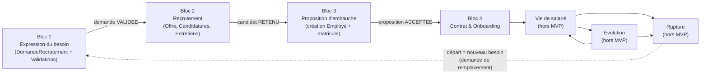

---

## 4. Processus métier (BPMN)

Convention : chaque processus est décrit par un diagramme (couloirs = acteurs) puis par un tableau d'étapes avec le **type d'élément BPMN** à utiliser dans un outil de modélisation (*Start Event, User Task, Service Task, Exclusive Gateway XOR, Parallel Gateway +, Timer Event, End Event*).

### 4.1 Processus 1 – Expression du besoin et validation

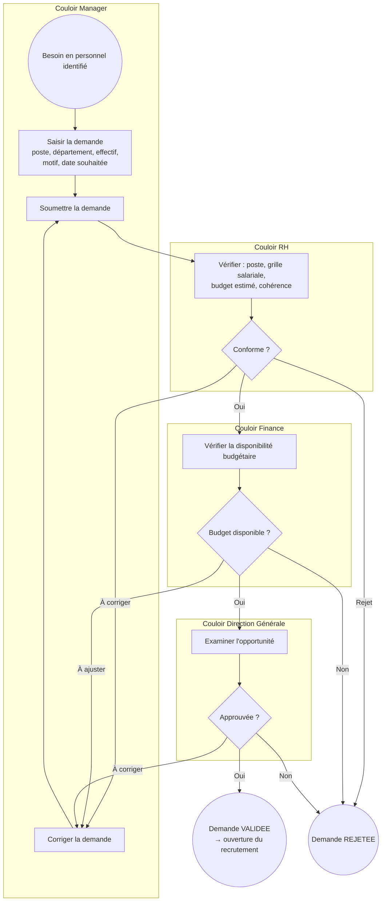

| Étape | Acteur | Élément BPMN | Entrée → Sortie |
|-------|--------|--------------|-----------------|
| Besoin identifié | Manager | Start Event | – |
| Saisir la demande | Manager | User Task | Demande en BROUILLON |
| Soumettre | Manager | User Task | Demande EN_VALIDATION_RH |
| Vérifier conformité | RH | User Task + Exclusive Gateway | Approuvée / Retournée / Rejetée |
| Vérifier budget | Finance | User Task + Exclusive Gateway | Approuvée / Retournée / Rejetée |
| Examiner opportunité | DG | User Task + Exclusive Gateway | Approuvée / Retournée / Rejetée |
| Notification du résultat | Système | Service Task | Notification au manager et à la RH |
| Fin | – | End Event (VALIDEE ou REJETEE) | – |

### 4.2 Processus 2 – Recrutement

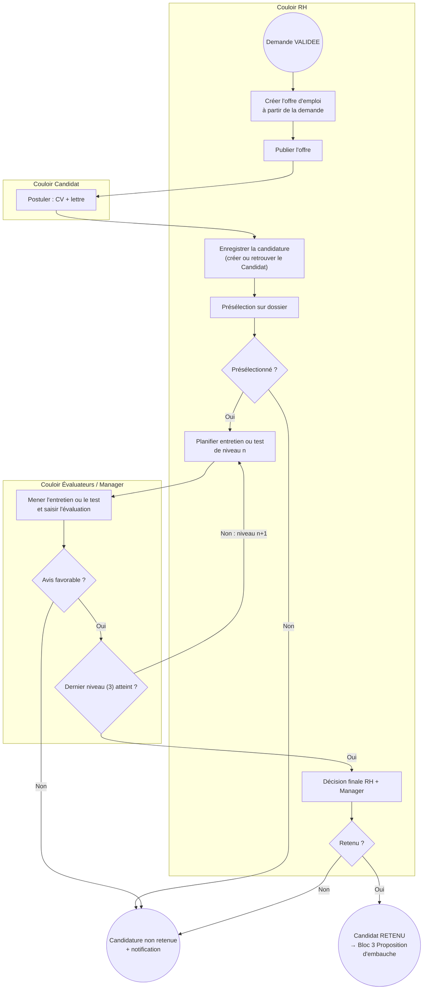

| Étape | Acteur | Élément BPMN | Remarque |
|-------|--------|--------------|----------|
| Créer l'offre | RH | User Task | Copie poste, effectif, profil depuis la demande validée |
| Publier | RH | User Task | Canal : site, réseaux, cabinet… |
| Postuler | Candidat | User Task (message start) | CV déposé = `Document` daté et versionné |
| Enregistrer candidature | Système / RH | Service Task | Dédoublonnage du candidat (email, téléphone) |
| Présélection | RH | User Task + XOR | Motif obligatoire en cas de refus |
| Niveau 1 / 2 / 3 | RH + Évaluateurs | User Task en boucle (*multi-instance*) | 1 = entretien RH, 2 = test technique, 3 = entretien final (paramétrable) |
| Évaluation | Évaluateur | User Task | Note, avis, commentaire |
| Décision finale | RH + Manager | User Task + XOR | Conservée avec date, auteur, motif |
| Notification | Système | Service Task | Au candidat, à chaque issue |

### 4.3 Processus 3 – Proposition d'embauche

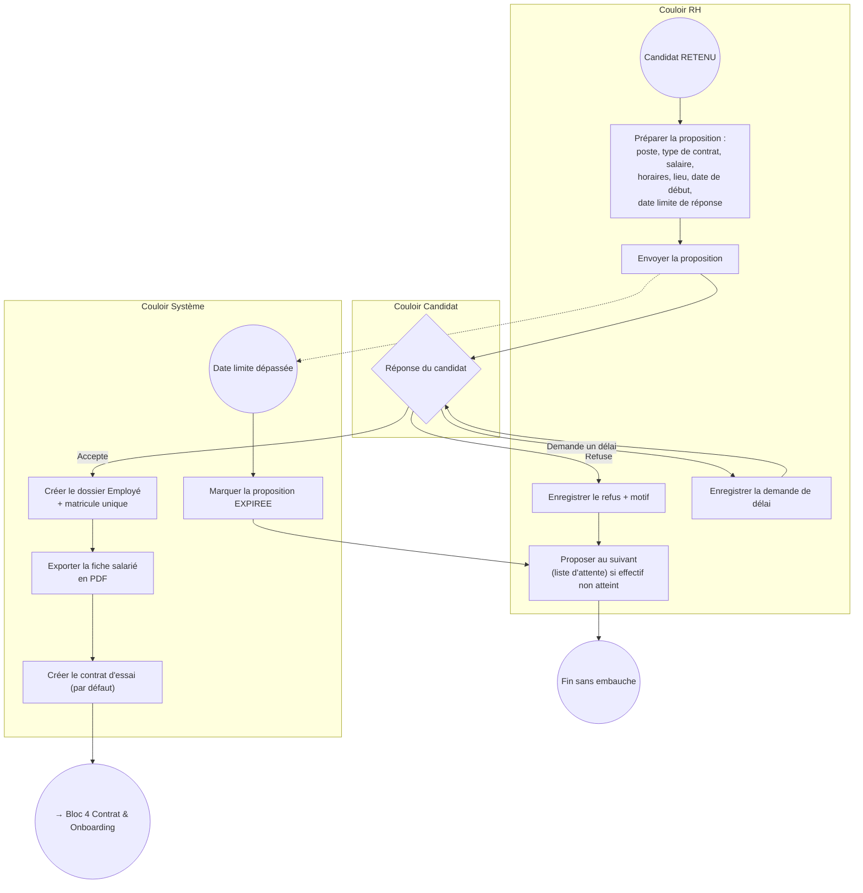

| Étape | Acteur | Élément BPMN | Remarque |
|-------|--------|--------------|----------|
| Préparer la proposition | RH | User Task | Mentions obligatoires : voir RG-22 |
| Envoyer | RH | User Task / Send Task | Document PDF joint, `Document` archivé |
| Réponse | Candidat | Event-based Gateway | Trois issues : accepter, refuser, attendre (délai) |
| Date limite | Système | Timer Boundary Event | Expiration automatique |
| Création Employé + matricule | Système | Service Task | Matricule unique et non réutilisable |
| Export PDF | Système | Service Task | Fiche salarié avec matricule |
| Création contrat d'essai | Système | Service Task | Contrat par défaut = **Essai** (RG-27) |

### 4.4 Processus 4 – Contrat et onboarding

```mermaid
flowchart TD
  subgraph RH["Couloir RH"]
    K0(("Employé créé"))
    K1["Générer le contrat<br/>(essai par défaut)"]
    K2["Envoyer pour signature"]
    K3{"Contrat signé ?"}
    K4["Activer le contrat<br/>+ créer l'Affectation initiale"]
    K5["Générer la checklist d'onboarding<br/>depuis le modèle"]
  end
  subgraph IT["IT / Services généraux"]
    T1["Créer les comptes"]
    T2["Préparer le badge"]
    T3["Préparer le matériel (facultatif)"]
  end
  subgraph PAIE["Paie"]
    T4["Inscrire le salarié en paie"]
  end
  subgraph MGR["Manager / RH"]
    T5["Planifier les formations (facultatif)"]
    T6["Accompagner l'ouverture<br/>du compte bancaire (facultatif)"]
  end
  J1{"Toutes les tâches<br/>obligatoires faites ?"}
  K6(("Onboarding TERMINE"))

  K0 --> K1 --> K2 --> K3
  K3 -->|"Non, relance"| K2
  K3 -->|"Oui"| K4 --> K5
  K5 --> T1
  K5 --> T2
  K5 --> T3
  K5 --> T4
  K5 --> T5
  K5 --> T6
  T1 --> J1
  T2 --> J1
  T3 --> J1
  T4 --> J1
  T5 --> J1
  T6 --> J1
  J1 -->|"Oui"| K6
  J1 -->|"Non, relance"| J1
```

| Étape | Acteur | Élément BPMN | Remarque |
|-------|--------|--------------|----------|
| Générer le contrat | RH | User Task | Type par défaut : Essai |
| Signature | RH + Salarié | User Task | Document signé téléversé (preuve) |
| Activation + Affectation | Système / RH | Service Task | Poste, département, manager, date de début |
| Génération de la checklist | Système | Service Task | À partir du `ModeleOnboarding` |
| Tâches d'intégration | IT, Paie, RH, Manager | Parallel Gateway (+) en divergence puis convergence | Tâches obligatoires et facultatives |
| Clôture | Système | Exclusive Gateway + End Event | Quand toutes les tâches obligatoires sont faites |

### 4.5 Sous-processus – Évolution du contrat

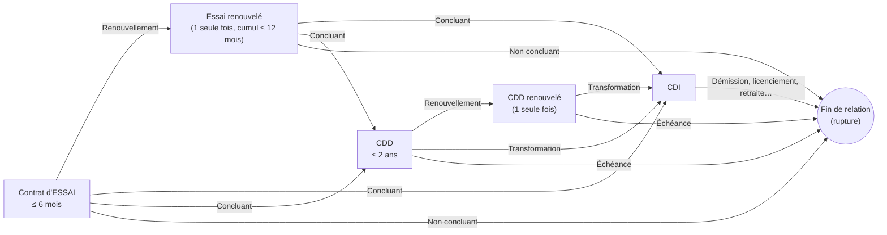

Chaque flèche = **un nouveau `Contrat` lié au précédent** (champ `contrat_precedent_id`). Rien n'est écrasé.

---

## 5. Modèle conceptuel de données (MCD)

Le modèle est découpé en 3 diagrammes pour rester lisible, puis complété par le tableau des cardinalités (notation Merise).

### 5.1 Diagramme A – Organisation et expression du besoin

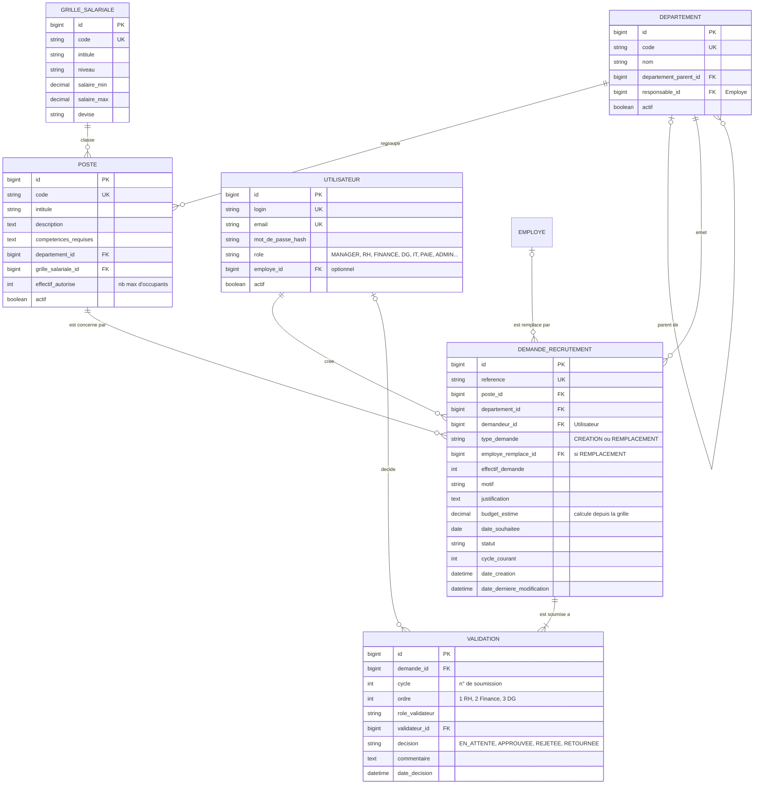

### 5.2 Diagramme B – Recrutement

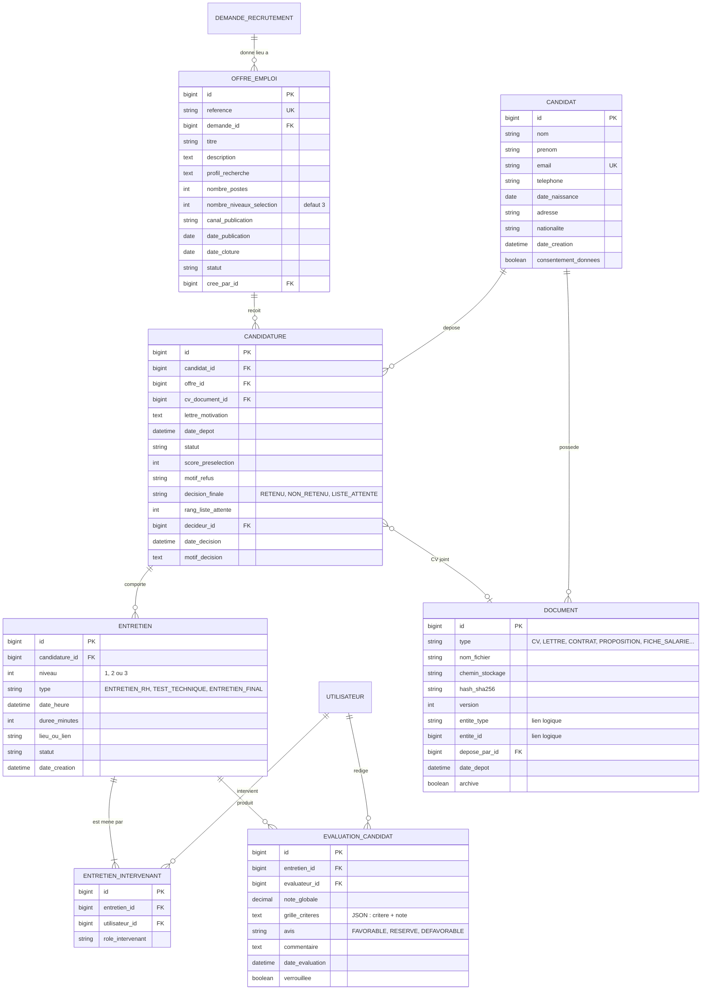

### 5.3 Diagramme C – Embauche, contrat et onboarding

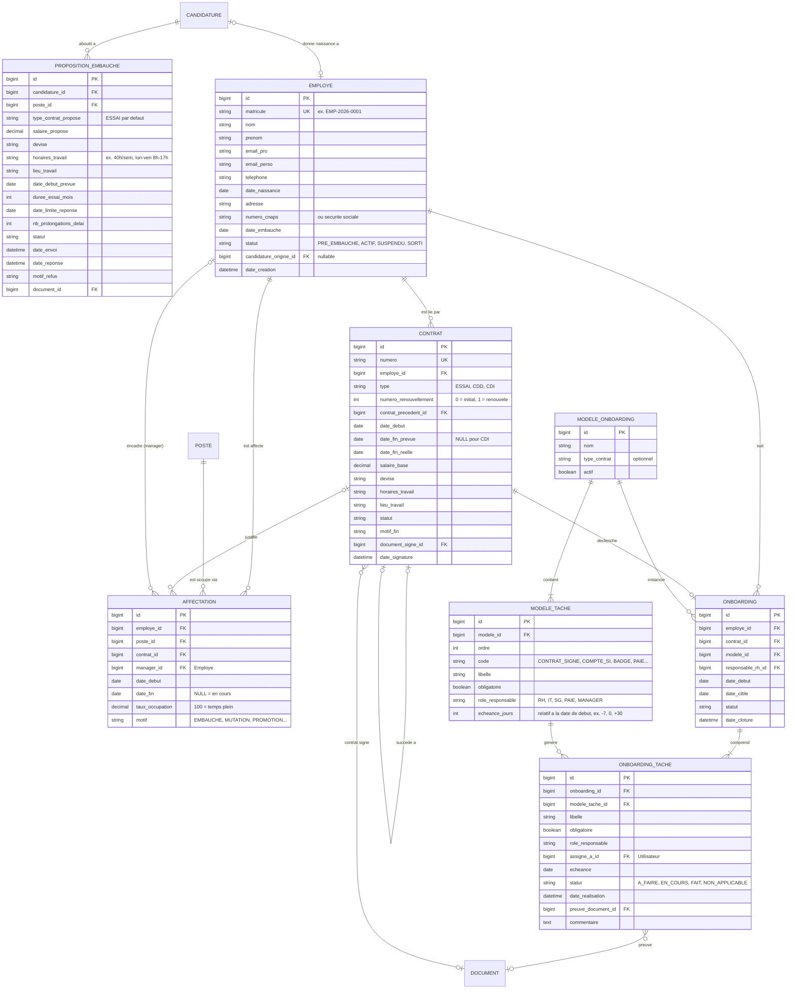

### 5.4 Entités transverses

| Entité | Rôle | Attributs principaux |
|--------|------|----------------------|
| **HistoriqueStatut** | Trace chaque changement de statut de n'importe quel objet métier | id, entite_type, entite_id, ancien_statut, nouveau_statut, auteur_id, date_changement, commentaire |
| **JournalAudit** | Trace technique de toute création / modification / suppression logique | id, entite_type, entite_id, action, valeurs_avant (JSON), valeurs_apres (JSON), auteur_id, date_action, adresse_ip |
| **Notification** | Notifications internes, email et push mobile | id, destinataire_id, type, message, entite_type, entite_id, canal, lue, date_creation |
| **Parametre** | Valeurs configurables (seuils, délais, durées) | cle, valeur, description |

Paramètres prévus : `delai_min_embauche_jours`, `coef_charges_patronales`, `duree_budget_mois`, `delai_reponse_proposition_jours`, `duree_prolongation_delai_jours`, `essai_duree_max_mois`, `essai_cumul_max_mois`, `cdd_duree_max_mois`, `alerte_fin_essai_jours`, `conservation_candidats_mois`.

### 5.5 Cardinalités (notation Merise)

Lecture : « chaque entité A participe à l'association avec la cardinalité indiquée à gauche ; chaque entité B avec celle indiquée à droite ».

| Entité A | Card. A | Association | Card. B | Entité B |
|----------|---------|-------------|---------|----------|
| POSTE | 1,1 | appartient à | 0,n | DEPARTEMENT |
| POSTE | 1,1 | est classé dans | 0,n | GRILLE_SALARIALE |
| DEMANDE_RECRUTEMENT | 1,1 | concerne | 0,n | POSTE |
| DEMANDE_RECRUTEMENT | 1,1 | est émise par | 0,n | DEPARTEMENT |
| DEMANDE_RECRUTEMENT | 1,1 | est créée par | 0,n | UTILISATEUR |
| DEMANDE_RECRUTEMENT | 0,1 | remplace | 0,n | EMPLOYE |
| VALIDATION | 1,1 | porte sur | 3,n | DEMANDE_RECRUTEMENT |
| OFFRE_EMPLOI | 1,1 | est issue de | 0,n | DEMANDE_RECRUTEMENT |
| CANDIDATURE | 1,1 | répond à | 0,n | OFFRE_EMPLOI |
| CANDIDATURE | 1,1 | est déposée par | 0,n | CANDIDAT |
| ENTRETIEN | 1,1 | concerne | 0,3 | CANDIDATURE |
| ENTRETIEN | 1,n | est mené par | 0,n | UTILISATEUR (via ENTRETIEN_INTERVENANT) |
| EVALUATION_CANDIDAT | 1,1 | évalue | 0,n | ENTRETIEN |
| PROPOSITION_EMBAUCHE | 1,1 | est faite à partir de | 0,n | CANDIDATURE |
| EMPLOYE | 0,1 | est issu de | 0,1 | CANDIDATURE |
| CONTRAT | 1,1 | lie | 0,n | EMPLOYE |
| CONTRAT | 0,1 | succède à | 0,1 | CONTRAT |
| AFFECTATION | 1,1 | affecte | 0,n | EMPLOYE |
| AFFECTATION | 1,1 | occupe | 0,n | POSTE |
| AFFECTATION | 0,1 | s'appuie sur | 0,n | CONTRAT |
| AFFECTATION | 0,1 | est encadrée par | 0,n | EMPLOYE (manager) |
| ONBOARDING | 1,1 | concerne | 0,n | EMPLOYE |
| ONBOARDING | 1,1 | est déclenché par | 0,1 | CONTRAT |
| ONBOARDING_TACHE | 1,1 | fait partie de | 1,n | ONBOARDING |
| MODELE_TACHE | 1,1 | fait partie de | 1,n | MODELE_ONBOARDING |

### 5.6 Contraintes d'intégrité principales

| Contrainte | Objet | Règle |
|-----------|-------|-------|
| Unicité | Candidature | Un couple (candidat, offre) unique |
| Unicité | Candidat | Email unique |
| Unicité | Employé | Matricule unique et jamais réutilisé |
| Unicité | Validation | Un couple (demande, cycle, ordre) unique |
| Unicité | Entretien | Un couple (candidature, niveau) actif unique |
| Non-chevauchement | Contrat | Un seul contrat ACTIF à un instant donné pour un employé |
| Non-chevauchement | Affectation | Une affectation ne chevauche pas une autre sur le même poste pour le même employé |
| Plafond | Affectation | Le nombre d'affectations actives sur un poste ≤ `effectif_autorise` |
| Cohérence | Contrat | `date_fin_prevue` obligatoire pour ESSAI et CDD, vide pour CDI |
| Immuabilité | Évaluation | Non modifiable une fois `verrouillee = true` |

---

## 6. Modèle UML – diagramme de classes du domaine

Vue orientée objet (avec les opérations métier principales) : elle sert de base aux **services métier** de l'API.

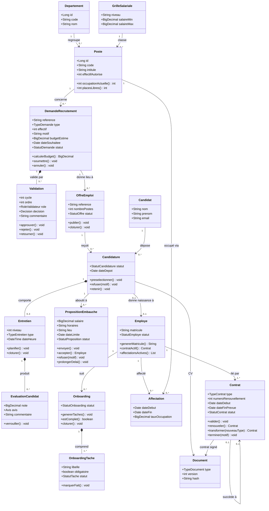

---

## 7. Énumérations (valeurs des statuts et types)

| Énumération | Valeurs |
|-------------|---------|
| **TypeDemande** | `CREATION`, `REMPLACEMENT` |
| **MotifDemande** (création) | `CROISSANCE`, `NOUVEAU_PROJET`, `RESTRUCTURATION`, `RENFORT_TEMPORAIRE`, `AUTRE` |
| **MotifDemande** (remplacement) | `DEMISSION`, `LICENCIEMENT`, `RETRAITE`, `MUTATION`, `FIN_CONTRAT`, `DECES`, `AUTRE` |
| **StatutDemande** | `BROUILLON`, `EN_VALIDATION_RH`, `EN_VALIDATION_FINANCE`, `EN_VALIDATION_DG`, `RETOURNEE`, `REJETEE`, `VALIDEE`, `EN_RECRUTEMENT`, `POURVUE`, `ANNULEE` |
| **DecisionValidation** | `EN_ATTENTE`, `APPROUVEE`, `REJETEE`, `RETOURNEE` |
| **StatutOffre** | `BROUILLON`, `PUBLIEE`, `CLOTUREE`, `ANNULEE` |
| **StatutCandidature** | `RECUE`, `PRESELECTIONNEE`, `REFUSEE_DOSSIER`, `EN_ENTRETIEN`, `NON_RETENUE`, `LISTE_ATTENTE`, `RETENUE`, `PROPOSITION_ENVOYEE`, `EMBAUCHEE`, `DESISTEE` |
| **TypeEntretien** | `ENTRETIEN_RH` (niveau 1), `TEST_TECHNIQUE` (niveau 2), `ENTRETIEN_FINAL` (niveau 3) |
| **StatutEntretien** | `PLANIFIE`, `REPORTE`, `REALISE`, `ANNULE`, `CANDIDAT_ABSENT` |
| **Avis** | `FAVORABLE`, `RESERVE`, `DEFAVORABLE` |
| **StatutProposition** | `BROUILLON`, `ENVOYEE`, `DELAI_ACCORDE`, `ACCEPTEE`, `REFUSEE`, `EXPIREE`, `RETIREE` |
| **StatutEmploye** | `PRE_EMBAUCHE`, `ACTIF`, `SUSPENDU`, `SORTI` |
| **TypeContrat** | `ESSAI`, `CDD`, `CDI` |
| **StatutContrat** | `BROUILLON`, `A_SIGNER`, `ACTIF`, `TERMINE`, `ANNULE` |
| **MotifFinContrat** | `ECHEANCE`, `RENOUVELLEMENT`, `TRANSFORMATION`, `ESSAI_NON_CONCLUANT`, `DEMISSION`, `LICENCIEMENT`, `RETRAITE`, `RUPTURE_CONVENTIONNELLE`, `AUTRE` |
| **StatutOnboarding** | `A_DEMARRER`, `EN_COURS`, `TERMINE`, `ANNULE` |
| **StatutTache** | `A_FAIRE`, `EN_COURS`, `FAIT`, `NON_APPLICABLE` |
| **MotifAffectation** | `EMBAUCHE`, `MUTATION`, `PROMOTION`, `REORGANISATION` |

---

## 8. Machines à états (cycles de vie des objets)

### 8.1 DemandeRecrutement

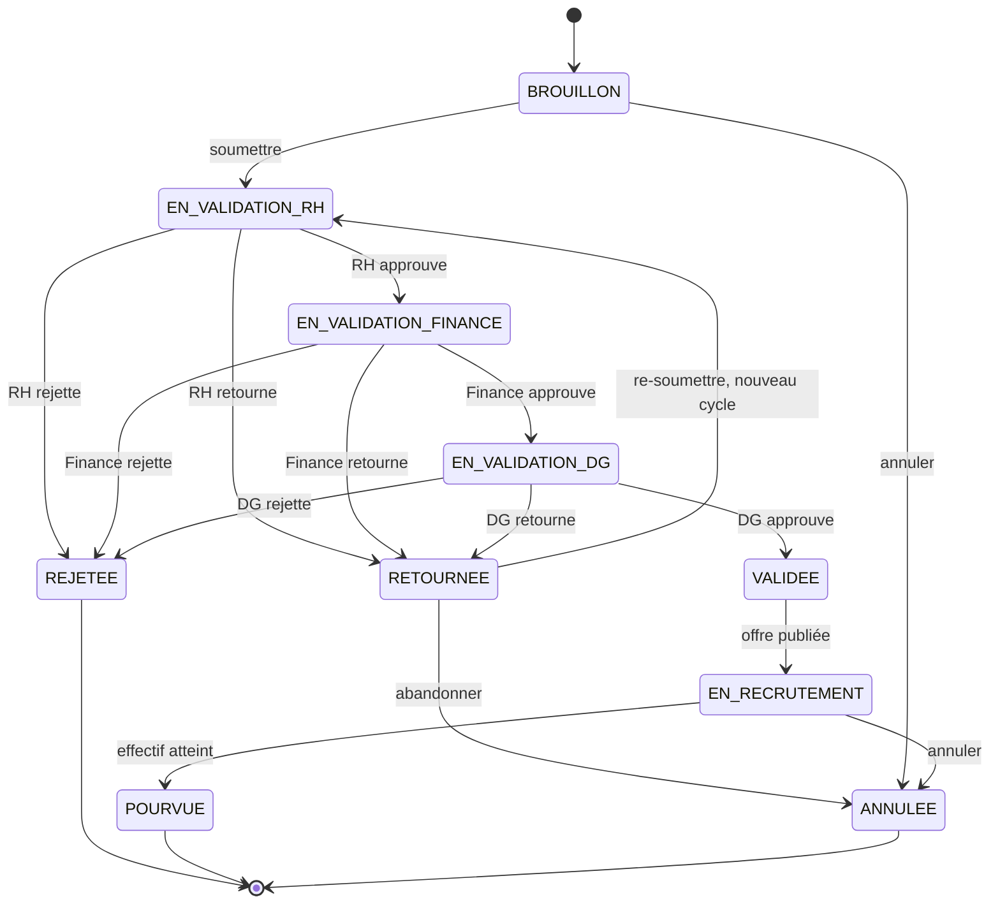

### 8.2 Candidature

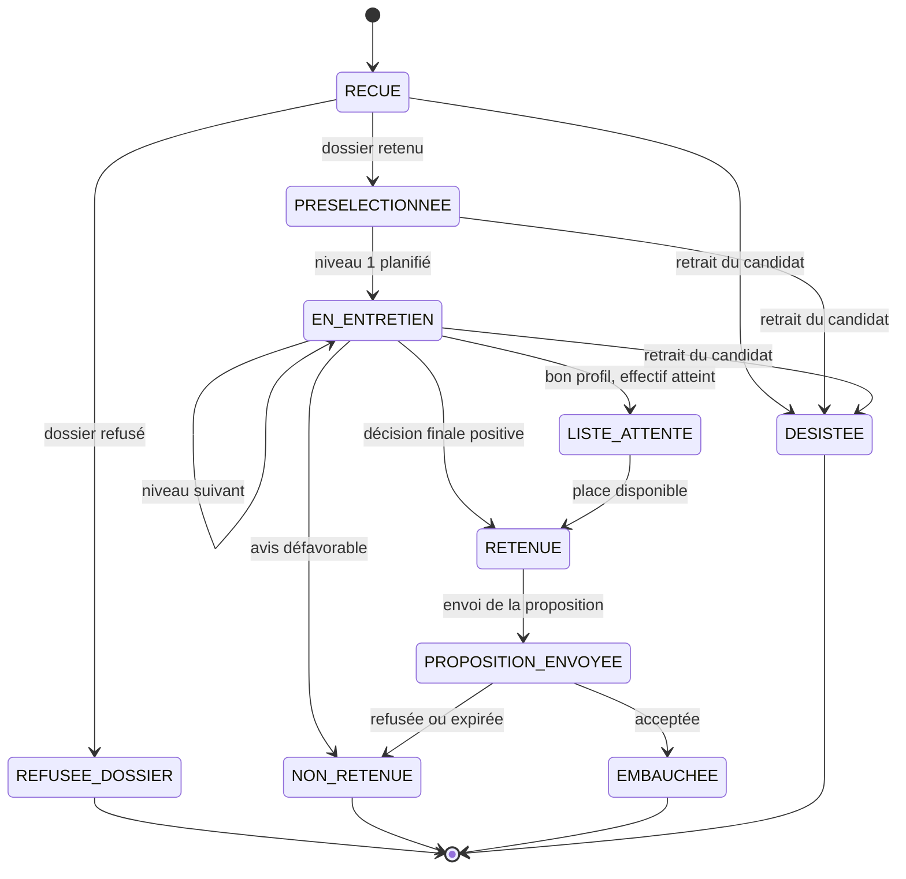

### 8.3 PropositionEmbauche

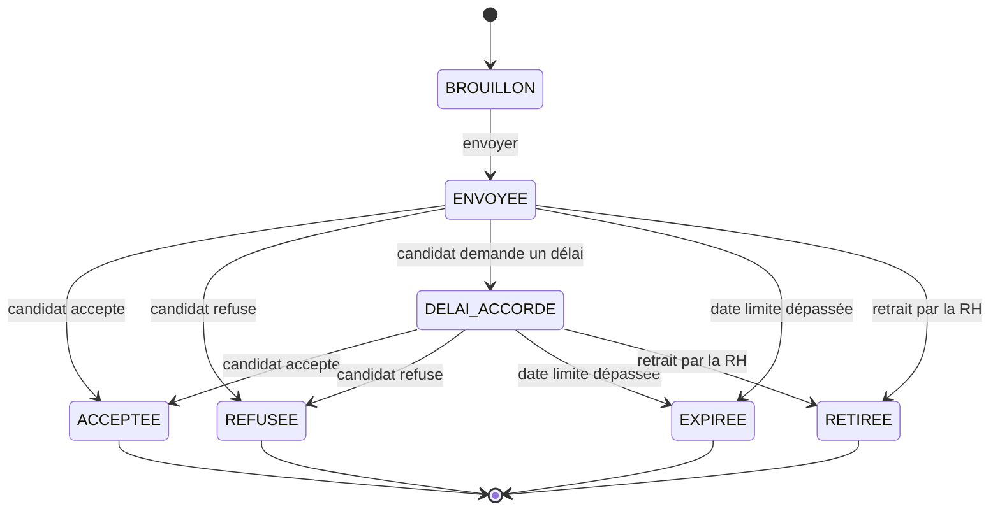

### 8.4 Contrat

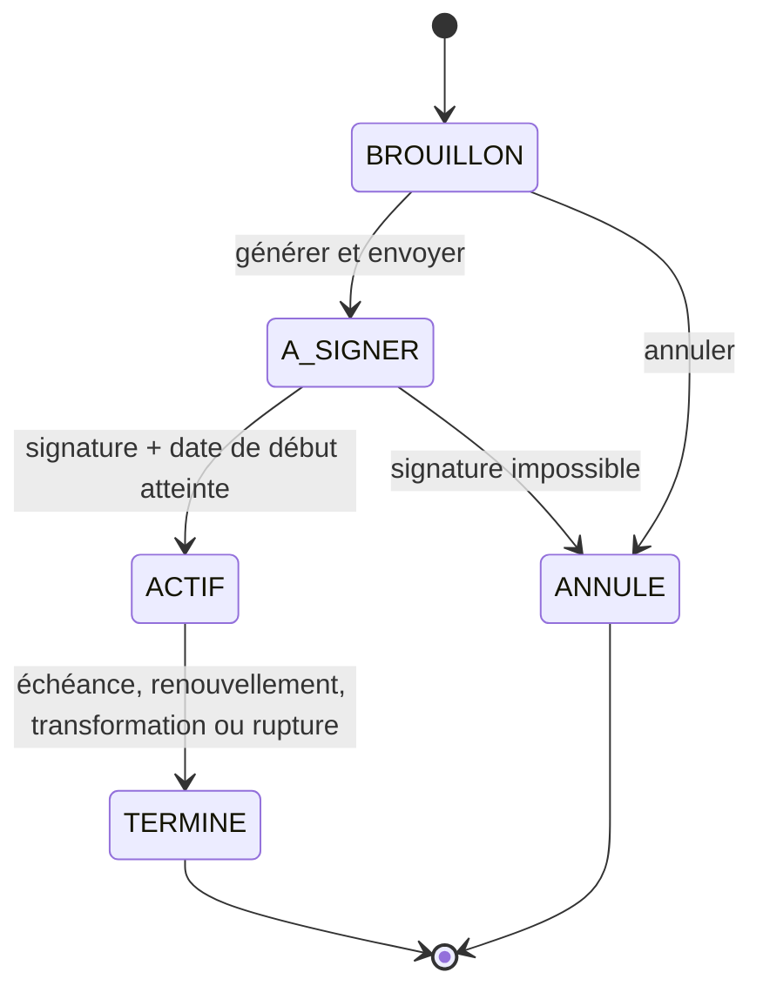

Le renouvellement ou la transformation termine le contrat courant (`motif_fin`) **et crée un nouveau contrat en BROUILLON** chaîné au précédent.

### 8.5 Employé

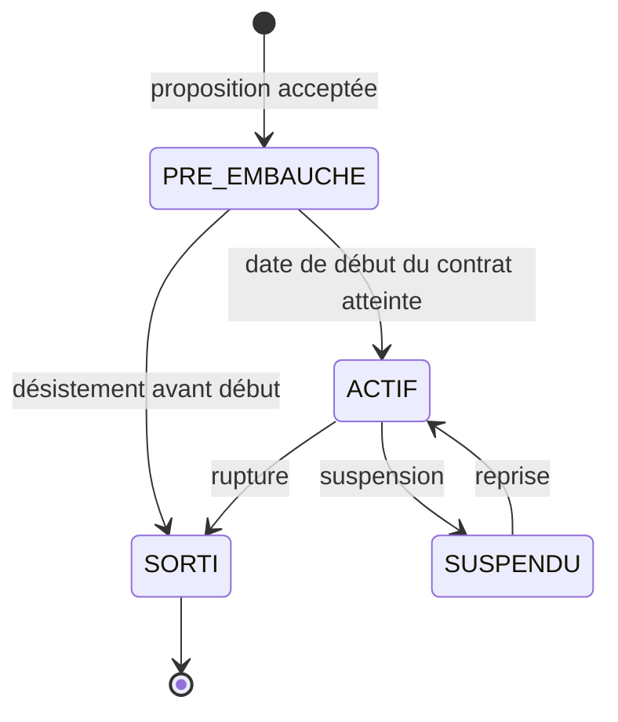

---

## 9. Workflows détaillés

### 9.1 Workflow de validation de la demande (Manager → RH → Finance → DG)

| Ordre | Validateur | Contrôle effectué | Issues possibles |
|-------|-----------|-------------------|------------------|
| 1 | **RH** | Poste existant, grille salariale, budget estimé cohérent, motif valide, effectif ≤ places libres (création) ou employé à remplacer valide | Approuver / Retourner / Rejeter |
| 2 | **Finance** | Enveloppe budgétaire disponible pour le département | Approuver / Retourner / Rejeter |
| 3 | **Direction Générale** | Opportunité stratégique | Approuver / Retourner / Rejeter |

**Mécanique :**
1. À la soumission, le système crée les 3 lignes `Validation` du cycle courant (ordre 1, 2, 3), la première en `EN_ATTENTE`.
2. Quand un validateur **approuve**, la ligne passe en `APPROUVEE` et la suivante passe en `EN_ATTENTE`.
3. Quand un validateur **retourne** : le statut devient `RETOURNEE`, le manager corrige et re-soumet. Un **nouveau cycle** (`cycle + 1`) est créé : les anciens cycles restent consultables.
4. Quand un validateur **rejette** : statut `REJETEE` (final), commentaire obligatoire.
5. Quand la dernière validation (DG) est approuvée : statut `VALIDEE`, notification à la RH qui peut ouvrir le recrutement.

### 9.2 Workflow de sélection des candidats

1. **Réception** : candidature `RECUE`, CV archivé et daté.
2. **Présélection sur dossier** par la RH : `PRESELECTIONNEE` ou `REFUSEE_DOSSIER` (motif).
3. **Niveau 1 : entretien RH** → évaluation → avis.
4. **Niveau 2 : test technique** (seulement si niveau 1 favorable) → évaluation → avis.
5. **Niveau 3 : entretien final** (seulement si niveau 2 favorable) → évaluation → avis.
6. **Décision finale** (RH + Manager) : `RETENU`, `LISTE_ATTENTE` ou `NON_RETENU`, avec date, auteur et motif.
7. **Notification** automatique au candidat à chaque issue.

### 9.3 Workflow de la proposition d'embauche

1. La RH prépare la proposition à partir de la candidature `RETENUE` (salaire dans la fourchette de la grille, horaires, lieu, date de début, type de contrat, date limite de réponse).
2. Envoi au candidat → `ENVOYEE`.
3. Le candidat dispose de **trois options** :
   - **Accepter** → création de l'employé + matricule + export PDF + contrat d'essai.
   - **Refuser** → motif enregistré, la RH peut proposer au candidat suivant de la liste d'attente.
   - **Attendre** (demande de délai) → `DELAI_ACCORDE`, nouvelle date limite (une seule prolongation).
4. Si la date limite est dépassée sans réponse : `EXPIREE`.

### 9.4 Workflow d'onboarding

1. À la création du contrat, génération des tâches depuis le `ModeleOnboarding`.
2. Tâches **obligatoires** : contrat signé, compte (accès SI), badge, inscription en paie.
3. Tâches **facultatives** : ouverture du compte bancaire, matériel nécessaire, formations.
4. Chaque tâche a un responsable (rôle), une échéance relative à la date de début et un statut.
5. L'onboarding passe `EN_COURS` à la première tâche démarrée, puis `TERMINE` quand **toutes les tâches obligatoires** sont `FAIT`.
6. Les tâches facultatives non traitées peuvent être marquées `NON_APPLICABLE`.

### 9.5 Modèle de checklist d'onboarding par défaut

| Ordre | Code | Tâche | Obligatoire | Responsable | Échéance |
|-------|------|-------|-------------|-------------|----------|
| 1 | CONTRAT_SIGNE | Contrat signé et archivé | Oui | RH | J-3 |
| 2 | PAIE | Inscription en paie | Oui | Paie | J-3 |
| 3 | COMPTE_SI | Création des comptes (email, applications) | Oui | IT | J-2 |
| 4 | BADGE | Remise du badge | Oui | Services généraux | J0 |
| 5 | MATERIEL | Matériel nécessaire (poste, téléphone…) | Non | IT / Services généraux | J-1 |
| 6 | COMPTE_BANCAIRE | Ouverture du compte bancaire | Non | RH | J+15 |
| 7 | FORMATION | Formations d'intégration | Non | Manager / RH | J+30 |

---

## 10. Règles de gestion (RG)

### Bloc 1 – Besoin et demande

| Code | Règle |
|------|-------|
| RG-01 | Un **Poste** est créé et maintenu par la RH, indépendamment de tout employé. Il rattache un département, une grille salariale et un `effectif_autorise`. |
| RG-02 | Un poste peut avoir **plusieurs occupants** simultanés. Le nombre d'affectations actives ne dépasse jamais `effectif_autorise`. |
| RG-03 | Une demande est de type `CREATION` ou `REMPLACEMENT`. En `REMPLACEMENT`, l'employé remplacé est obligatoire et l'effectif demandé ≤ nombre d'employés concernés. |
| RG-04 | Pour une `CREATION`, l'effectif demandé ≤ places libres du poste (`effectif_autorise` − occupation actuelle − demandes en cours). Sinon la RH doit d'abord relever l'effectif autorisé du poste. |
| RG-05 | Le **budget estimé** est **calculé** : salaire de référence de la grille × effectif × durée budgétée × (1 + coefficient de charges). Le manager ne le saisit pas librement. |
| RG-06 | La date souhaitée ≥ date du jour + délai minimal (paramètre `delai_min_embauche_jours`). |
| RG-07 | Un manager ne crée de demande que pour **son** département. |
| RG-08 | La chaîne de validation est **séquentielle et obligatoire** : RH → Finance → DG, sans saut d'étape. |
| RG-09 | Un validateur ne peut pas valider une demande qu'il a lui-même créée (séparation des rôles). |
| RG-10 | Un **rejet** ou un **retour** exige un commentaire. Un rejet est définitif. |
| RG-11 | Une demande soumise n'est plus modifiable. Seul l'état `RETOURNEE` permet la correction. |
| RG-12 | Un retour crée un **nouveau cycle** de validation ; l'historique des cycles précédents est conservé. |
| RG-13 | À l'approbation finale du DG, la demande passe `VALIDEE` et le recrutement peut être ouvert. |

### Bloc 2 – Recrutement

| Code | Règle |
|------|-------|
| RG-14 | Une **offre** ne peut être créée qu'à partir d'une demande `VALIDEE` ou `EN_RECRUTEMENT`. Son nombre de postes ≤ effectif restant à pourvoir. |
| RG-15 | La publication et la clôture d'une offre sont réservées à la RH. |
| RG-16 | Un **candidat** est unique (email). Il peut postuler à plusieurs offres, mais **une seule candidature par offre**. |
| RG-17 | Une candidature n'est acceptée que si l'offre est `PUBLIEE` et avant sa date de clôture. |
| RG-18 | Un refus au stade du dossier exige un motif. |
| RG-19 | La sélection comporte **3 niveaux séquentiels** (par défaut : entretien RH, test technique, entretien final). Le niveau n+1 n'est planifiable que si le niveau n a un avis `FAVORABLE`. |
| RG-20 | Chaque entretien a au moins un intervenant et reçoit au moins une évaluation avant de pouvoir être clôturé. |
| RG-21 | Une évaluation est **verrouillée** après validation. Toute correction passe par une nouvelle version tracée, jamais par une modification silencieuse. |
| RG-22 | La **décision finale** (RH + Manager) n'est possible qu'après tous les niveaux requis par l'offre. Elle est datée, signée et motivée. |
| RG-23 | Aucune donnée de recrutement n'est supprimée physiquement (CV, évaluations, décisions) : suppression logique et archivage uniquement. |
| RG-24 | Quand le nombre de propositions acceptées atteint l'effectif demandé, l'offre est **clôturée** automatiquement et la demande passe `POURVUE`. Les autres candidats bien classés restent en `LISTE_ATTENTE`. |
| RG-25 | Les données des candidats non retenus ne sont conservées que pour la durée paramétrée (`conservation_candidats_mois`), sauf consentement de maintien en vivier. |

### Bloc 3 – Proposition d'embauche

| Code | Règle |
|------|-------|
| RG-26 | Une proposition n'est créée que pour une candidature `RETENUE`. |
| RG-27 | La proposition mentionne obligatoirement : poste, type de contrat, **montant du salaire**, **horaires de travail**, **lieu de travail**, date de début, durée d'essai, date limite de réponse. Le salaire reste dans la fourchette de la grille ; au-delà, une dérogation DG est nécessaire. |
| RG-28 | Le candidat a **trois choix** : accepter, refuser, ou demander un délai. Un délai ne peut être accordé **qu'une seule fois**. |
| RG-29 | Sans réponse à la date limite, la proposition passe `EXPIREE` automatiquement. |
| RG-30 | En cas de refus ou d'expiration, la RH peut proposer au candidat suivant de la liste d'attente tant que l'effectif n'est pas atteint. |
| RG-31 | À l'**acceptation**, le système crée automatiquement l'**employé** (statut `PRE_EMBAUCHE`) avec un **matricule unique** (format `EMP-AAAA-NNNN`), jamais réutilisé, et génère la fiche salarié en **PDF**. |
| RG-32 | Le `Candidat` et la `Candidature` restent intacts après l'embauche. L'employé garde un lien vers la candidature d'origine (traçabilité). |

### Bloc 4 – Contrat et onboarding

| Code | Règle |
|------|-------|
| RG-33 | Le contrat créé par défaut après acceptation est le **contrat d'essai**. |
| RG-34 | **Contrat d'essai** : durée initiale ≤ **6 mois**, renouvelable **une seule fois**, durée cumulée ≤ **12 mois**. |
| RG-35 | **CDD** : durée ≤ **2 ans**, renouvelable **une seule fois**. Il est facultatif (non systématique). |
| RG-36 | **CDI** : pas de date de fin. |
| RG-37 | Un employé peut avoir **plusieurs contrats successifs** (essai, essai renouvelé, CDD, CDI…). Chacun est une ligne distincte chaînée au précédent. Aucune valeur n'est écrasée. |
| RG-38 | Un seul contrat `ACTIF` à la fois par employé. Le type de contrat « courant » est **dérivé** du contrat actif, jamais stocké sur l'employé. |
| RG-39 | Un contrat ne devient `ACTIF` que si le document signé est déposé et la date de début atteinte. |
| RG-40 | Alertes automatiques à la RH avant la fin d'un essai ou d'un CDD (paramètre `alerte_fin_essai_jours`, par défaut 30 jours). |
| RG-41 | À l'activation du contrat, une **Affectation** initiale est créée (poste, département, manager, date de début). Les changements ultérieurs ferment l'affectation précédente et en ouvrent une nouvelle. |
| RG-42 | L'**onboarding** est créé automatiquement avec le contrat, avec les tâches du modèle correspondant. |
| RG-43 | Tâches **obligatoires** : contrat signé, compte, badge, inscription en paie. Tâches **facultatives** : ouverture du compte bancaire, matériel, formations. |
| RG-44 | L'onboarding passe `TERMINE` quand toutes les tâches obligatoires sont `FAIT`. |
| RG-45 | L'employé passe `ACTIF` à la date de début du contrat actif. |

### Règles transverses

| Code | Règle |
|------|-------|
| RG-46 | Toute création, modification ou changement de statut est enregistré (qui, quand, avant, après). |
| RG-47 | Pas de suppression physique des données métier : suppression logique et archivage. |
| RG-48 | Chaque action est contrôlée par le **rôle** de l'utilisateur (section 12). |
| RG-49 | Notifications automatiques à chaque transition importante (demande à valider, décision, entretien planifié, proposition envoyée, tâche d'onboarding assignée, échéance proche). |
| RG-50 | Les documents (CV, proposition, contrat, fiche salarié) sont stockés avec version, empreinte (hash) et date de dépôt. |

---

## 11. Traçabilité et audit

| Exigence du sujet | Réponse dans le modèle |
|-------------------|------------------------|
| « CV, date, candidat » traçables | `Candidature.cv_document_id` → `Document` (version, date, hash) + `date_depot` + lien `candidat_id` |
| « Toutes les historiques doivent être traçables » | `HistoriqueStatut` (transitions) + `JournalAudit` (valeurs avant/après) sur tous les objets |
| Historique des validations | `Validation` conserve chaque décision de chaque cycle |
| Historique des contrats | Un contrat = une ligne, chaînée via `contrat_precedent_id` |
| Historique des postes occupés | `Affectation` avec `date_debut` / `date_fin` |
| Historique des évaluations | `EvaluationCandidat` verrouillée, versions tracées |
| Décision finale | `Candidature.decision_finale` + décideur + date + motif, et `HistoriqueStatut` |

---

## 12. Droits par rôle

Légende : **C** = créer, **L** = lire, **M** = modifier, **V** = valider / décider, **–** = aucun accès. *(own)* = limité à ses propres objets / son périmètre.

| Fonction | Manager | RH | Finance | DG | Intervenant | IT / SG | Paie | Salarié |
|----------|---------|----|---------|----|-------------|---------|------|---------|
| Départements, postes, grilles | L | C, M, L | L | L | – | – | – | – |
| Demande de recrutement | C, M (own, brouillon), L (own dép.) | L, V (étape 1) | L, V (étape 2) | L, V (étape 3) | – | – | – | – |
| Offre d'emploi | L | C, M, L | – | – | – | – | – | – |
| Candidatures | L (own dép.) | C, M, L | – | – | L (ses entretiens) | – | – | – |
| Entretiens | L | C, M, L | – | – | L (own) | – | – | – |
| Évaluations | L, C (si intervenant) | L | – | – | C, L (own) | – | – | – |
| Décision finale | V | V | – | – | – | – | – | – |
| Proposition d'embauche | L | C, M, L | – | V (dérogation salaire) | – | – | – | – |
| Dossier employé | L (own équipe) | C, M, L | – | – | – | – | L (limité) | L (own) |
| Contrat | L (own équipe) | C, M, L | – | – | – | – | L | L (own) |
| Onboarding / tâches | L, M (ses tâches) | C, M, L | – | – | – | M (ses tâches) | M (ses tâches) | L (own) |
| Journal d'audit | – | L | – | L | – | – | – | – |
| Paramètres / référentiels | – | L | – | – | – | – | – | – |

L'**Administrateur** gère comptes, rôles et paramètres, sans accès aux contenus RH sensibles par défaut.

---

## 13. Cas d'utilisation du MVP

| ID | Cas d'utilisation | Acteur principal | Bloc |
|----|-------------------|------------------|------|
| UC-01 | Gérer les départements, postes et grilles salariales | RH | 1 |
| UC-02 | Créer et soumettre une demande de recrutement | Manager | 1 |
| UC-03 | Valider, retourner ou rejeter une demande | RH, Finance, DG | 1 |
| UC-04 | Suivre l'état et l'historique d'une demande | Manager, RH | 1 |
| UC-05 | Créer et publier une offre d'emploi | RH | 2 |
| UC-06 | Enregistrer et présélectionner les candidatures | RH | 2 |
| UC-07 | Planifier un entretien ou un test (niveaux 1 à 3) | RH | 2 |
| UC-08 | Saisir l'évaluation d'un entretien | Intervenant | 2 |
| UC-09 | Prendre la décision finale | RH, Manager | 2 |
| UC-10 | Préparer et envoyer la proposition d'embauche | RH | 3 |
| UC-11 | Enregistrer la réponse du candidat (accepter, refuser, délai) | RH (ou Candidat via lien) | 3 |
| UC-12 | Créer automatiquement l'employé + matricule + fiche PDF | Système | 3 |
| UC-13 | Générer et activer le contrat d'essai | RH | 4 |
| UC-14 | Renouveler ou transformer un contrat (essai → CDI ou CDD…) | RH | 4 |
| UC-15 | Piloter la checklist d'onboarding | RH, IT, Paie, Manager | 4 |
| UC-16 | Consulter son onboarding et signer (mobile) | Salarié | 4 |
| UC-17 | Valider rapidement une demande depuis le mobile + notifications | Manager, DG | 1 |

---

## 14. Périmètre MVP / hors périmètre

| Inclus dans le MVP | Modélisé mais hors MVP (extensions) |
|--------------------|-------------------------------------|
| Blocs 1 à 4 de bout en bout | **Vie de salarié** : congés, absences, présence, dossier médical |
| Workflow de validation à 3 niveaux | **Évolution** : promotion, mutation, avenant, révision salariale (l'`Affectation` est déjà prête) |
| Offres, candidatures, 3 niveaux de sélection | **Rupture** : démission, licenciement, solde de tout compte, déclenchement d'une demande de remplacement |
| Proposition d'embauche avec 3 réponses | Portail candidat externe complet |
| Création automatique employé + matricule + PDF | Paie complète (seule l'inscription est suivie) |
| Contrats successifs avec règles de durée | Signature électronique légale |
| Checklist d'onboarding | Reporting / BI avancé |
| Audit, historique, rôles, notifications | Intégrations externes (job boards, comptabilité) |

Pistes futures dans le modèle : `Avenant`, `Absence`, `DemandeConge`, `Evolution`, `Rupture`, `SoldeToutCompte`.

---

## 15. Hypothèses et points à valider avec l'enseignant

Le sujet laisse certains points ouverts. Voici les choix retenus ici, à confirmer :

| # | Point | Hypothèse retenue |
|---|-------|-------------------|
| H1 | « CE par défaut » | **CE = contrat d'essai**. |
| H2 | « Essai : 6 mois, renouvelable 1 fois en 1 an » | Durée initiale ≤ 6 mois, 1 seul renouvellement, cumul ≤ 12 mois. |
| H3 | « CDD : 2 ans, renouvelable 1 fois » | Durée ≤ 2 ans, 1 seul renouvellement. **Ambigu** : le plafond de 2 ans s'applique-t-il au contrat initial seul, ou renouvellement inclus ? Modélisation prête pour les deux (paramètres). |
| H4 | « Validation Finance selon le budget » | Chaîne fixe RH → Finance → DG. Variante possible : seuil de budget en dessous duquel la Finance ou la DG est sautée (paramétrable, non retenue par défaut). |
| H5 | « 3 niveaux d'entretiens et tests » | Niveau 1 : entretien RH, niveau 2 : test technique, niveau 3 : entretien final (types paramétrables par offre). |
| H6 | « Accepter, refuser, attendre » | « Attendre » = demande d'un délai de réflexion, accordé une seule fois. |
| H7 | Matériel et formation | Listés à la fois dans les tâches d'onboarding et dans les éléments « facultatifs » : retenus comme **facultatifs**. Contrat signé, compte, badge et paie : **obligatoires**. |
| H8 | Mentions du contrat de travail | Salaire, horaires, lieu, date de début, durée d'essai (« à vérifier sur un modèle de contrat » : à comparer avec un modèle réel du droit du travail applicable, par ex. celui de Madagascar). |
| H9 | Retour d'un ancien salarié | Non traité dans le MVP (à décider : réactivation du matricule ou nouveau matricule). |
| H10 | Remplacement | L'employé remplacé reste dans la base (statut `SORTI` ou en cours de départ) pour la traçabilité. |

---

*Fin du document de conception. Étape suivante : architecture technique (modules Spring Boot, endpoints REST, sécurité), puis plan de développement du MVP.*
